# uefirrw

**UEFI Resource Read & Write Tool** — a text-mode hardware read/write utility that runs in the UEFI Shell (or boots directly as `BOOTX64.EFI`). No OS needed.

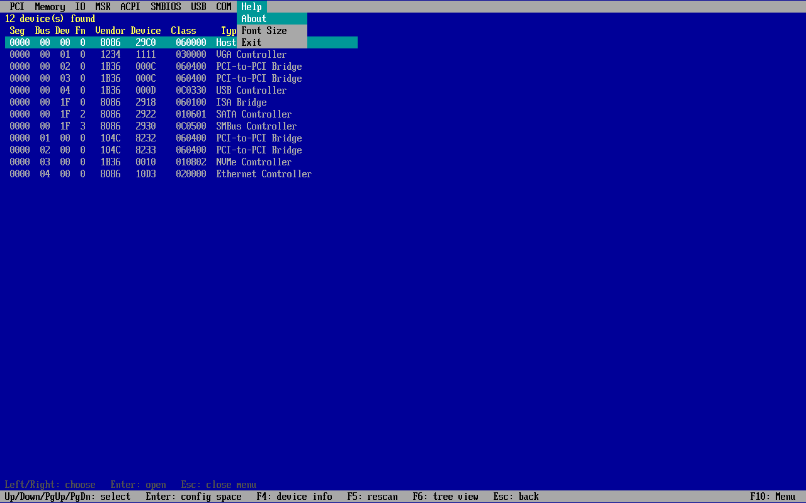

## About this project

This tool was developed collaboratively with AI. You are welcome to copy, use, modify, redistribute and improve it under the terms of the license below. Pull requests, bug reports and forks are all welcome.

**Who it is for:** BIOS/firmware engineers, hardware validation and bring-up teams, and anyone who needs to inspect hardware registers before an OS is installed.

## ⚠️ Warning: use at your own risk

This tool reads and writes hardware registers directly. Using it may cause system hangs, data loss, corrupted firmware settings or permanent hardware damage. **You use it entirely at your own risk.** The authors and contributors accept no responsibility or liability for any damage or loss of any kind resulting from its use. The software is provided "AS IS", without warranty of any kind.

Higher-risk operations include:

- Writing PCI config space (BARs, command register, bridge bus numbers, PCIe link control)
- Writing MMIO or memory, especially chipset, SPI flash or ACPI regions
- Writing IO ports (e.g. CF9h reset, CMOS, Super I/O, EC)
- Writing MSRs (can hang the CPU, change voltage, frequency or lock bits)

Recommendations:

- Try it on a test or development machine first, not on production systems.
- Note the original value before writing, so you can restore it.
- Have a way to recover the BIOS (backup image, SPI programmer, or dual BIOS).
- Reading is generally safe. **Writes are applied immediately when you press Enter, with no confirmation** (including IO CF9h, which resets the machine).

## Features (v0.8)

The tool opens on the PCI list. `F10` (or `Esc` out of a screen) opens the menu bar; each entry drops down a list:

| Menu | Entries |
|---|---|
| **File** | Save Screen as Text, Screenshot (`F12`), Dump All to File, File Browser, Text Editor, Return to Setup, Warm Reset, Cold Reset, Exit |
| **Bus** | PCI, USB |
| **Space** | Memory, IO, MSR, CMOS, EC |
| **Tables** | ACPI, SMBIOS |
| **Devices** | Super I/O, COM Port |
| **Help** | Keys (`F1`), About |

Left/Right picks a menu, Up/Down an entry, Enter opens it. `F1` on any screen lists that screen's keys; `F12` on any screen saves a screenshot.


| Module | What it does |
|---|---|
| **PCI** | Scans every PCI root bridge (segment aware), lists Seg/Bus/Dev/Fn, vendor/device ID, class code and type. Enter opens the config space editor (256 B, or 4 KB extended space when reachable). `F4` shows device info: header, BARs, bridge windows, and every capability and extended capability decoded (PM, MSI, MSI-X, PCI Express incl. link/slot/LnkCap2, AER with error names, Device Serial Number, SR-IOV, Resizable BAR, LTR, L1 PM Substates, ARI, VSEC/DVSEC, ...). `F6` switches to a PCIe tree: root bridge -> root port -> switch -> endpoint, with bridge bus ranges, PCIe port type and current/max link speed and width. |
| **Memory / MMIO** | Hex view/edit of any physical address (byte/word/dword access via MMIO reads). |
| **IO Space** | Hex view/edit of x86 IO ports 0000-FFFF in byte/word/dword width. |
| **MSR** | Boot-processor MSR list with common architectural MSRs, 64-bit bit view, add any MSR, write (`W`). A temporary #GP handler skips faulting RDMSR/WRMSR so unsupported MSRs report an error instead of hanging. |
| **SMBIOS** | Finds the SMBIOS 3.x (or 2.x) entry point, lists every structure (type, handle, length, name). Enter shows decoded fields (types 0, 1, 2, 3, 4, 7, 8, 9, 11, 12, 13, 16, 17, 19, 32, 41), the string set, and a raw dump. |
| **USB Devices** | Tree of host controllers (xHCI/EHCI/OHCI/UHCI with PCI location), root hub ports, hubs and devices with VID:PID, product string, class and speed. Enter on a device shows connection info, the device descriptor, the full configuration set (interfaces, endpoints, HID, IAD, SuperSpeed companion), hub port status and raw descriptors; Enter on a controller shows its root port status. `F6` turns on auto refresh every 5 s for hot-plug testing: newly attached devices show green `[new]` and removed devices stay in place in red `[removed]` for 20 s. Read-only. |
| **ACPI Tables** | RSDP, XSDT/RSDT and every table (plus DSDT and FACS from the FADT) with OEM IDs, length, address and checksum check. Enter decodes the header and FADT, MADT (CPU count), MCFG (ECAM), HPET and DMAR (VT-d), then shows the raw bytes. In DSDT/SSDT, `F7` switches to ASL source from the built-in AML disassembler, and `F2` saves `DSDTn.aml` and `DSDTn.dsl` next to uefirrw.efi. `/` (or Ctrl+F) finds text in any detail page, `F3` or `n` finds the next match. |
| **COM Port Test** | Detects 16550 UARTs at 3F8h, 2F8h, 3E8h, 2E8h (or any IO base) and opens a polled terminal: upper window ASCII, lower window hex, sent bytes yellow and received white. Type to send, `Tab` for raw hex input, `F2` baud (9600-115200, 8N1), `F4` internal loopback self-test, `F5` hide sent bytes, `F6` Enter as CR / CR+LF / LF. Shows LSR/MSR, modem lines and overrun/framing/parity counts. The firmware's serial console on that port is paused while testing and restored on exit. |
| **File** | *Save Screen as Text* writes `SCRnnnn.TXT`, *Screenshot* (`F12` anywhere) writes a 24-bit `SCRnnnn.BMP`, *Dump All* writes `DUMPnnnn.TXT` with PCI (list, tree, every device's info), ACPI (every table decoded plus ASL of DSDT/SSDT), SMBIOS, USB and Super I/O. Files go to the volume uefirrw.efi was loaded from. *File Browser* lists every FAT volume (shell names such as `FS0:` when started from the Shell), folders and files with size and date; Enter opens text files in the editor and other files as hex, `F6` creates a file. *Text Editor* edits ASCII or UTF-16 files and keeps their CR LF / LF line ends (`F2` save, `Ctrl+F` find, `Ctrl+Y` delete line). *Return to Setup* starts the firmware's setup application from its boot option (or shows the HII forms) and comes back to uefirrw when you leave setup; if neither exists it tells you to exit and type `exit` in the shell. *Warm / Cold Reset* reset at once. |
| **CMOS** | Hex view/edit of CMOS/RTC RAM: 00h-7Fh through ports 70h/71h, 80h-FFh (upper bank) through 72h/73h. |
| **Super I/O** | Probes 2Eh and 4Eh with the Nuvoton/Winbond, Fintek, ITE, SMSC/Microchip and ASPEED BMC (AST2400/2500/2600, A5h A5h) entry sequences, shows the chip ID and every logical device (LDN) with active bit, base addresses 60h/62h and IRQs 70h/72h. Enter edits that LDN's config registers; the chip is unlocked only for each access and locked again after it. |
| **EC** | Hex view/edit of Embedded Controller RAM (00h-FFh) through the ACPI EC interface (read 80h / write 81h), on 62h/66h or any port pair you enter. |

Hex editor keys: arrows move, PgUp/PgDn change page, `W` cycles Byte/Word/DWord, `G` goes to an address, `F5` re-reads, type hex digits to edit (Enter or a full value commits; every write is read back and verified), `Esc` goes back.

Writes take effect as soon as you press Enter; there is no confirmation prompt.

| PCI devices | PCI config space |
|---|---|
|  |  |

| IO space | MSR |
|---|---|
|  |  |

Display: when the firmware exposes GOP, uefirrw draws its own 8x19 text (the edk2 font) at the panel's native resolution, with an integer font scale picked automatically so the grid fills the screen with at least 100x25 cells (e.g. 1920x1080 -> 120x28 at x2, 1024x768 -> 128x40 at x1). Help > About shows the resolution, grid and scale. Only changed cells are redrawn, so cursor movement stays fast even with serial console redirection enabled. Without GOP it falls back to the firmware text console.

| SMBIOS | USB tree |
|---|---|
|  |  |

| PCIe tree | COM port test |
|---|---|
| 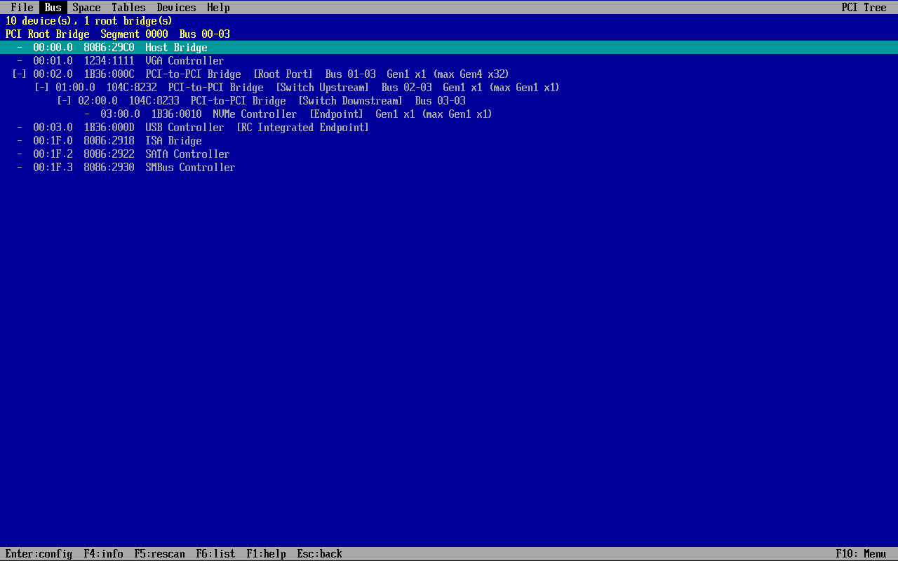 | 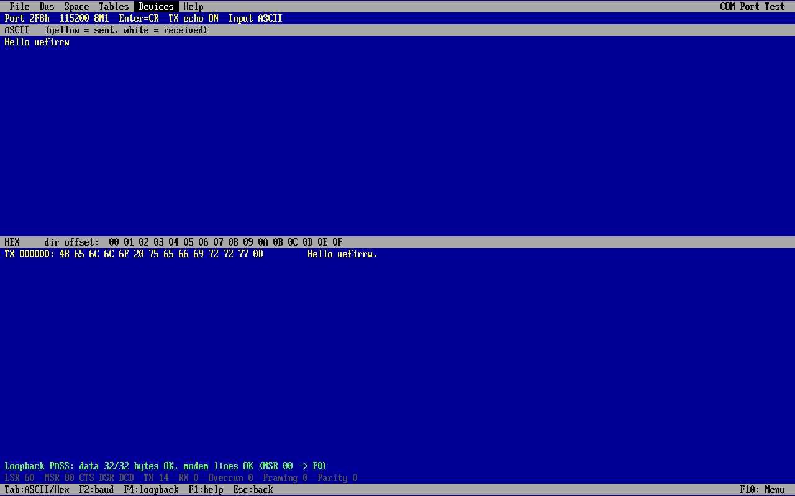 |

| PCI device info | ACPI tables |
|---|---|
| 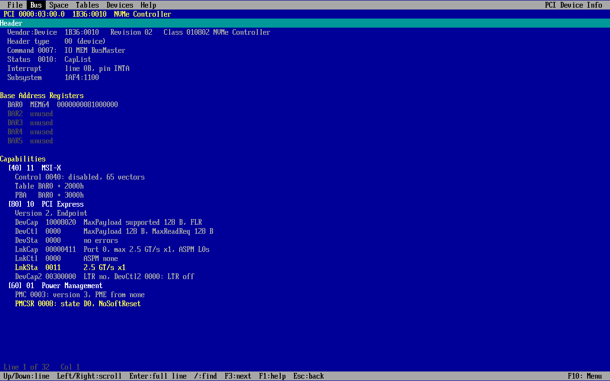 | 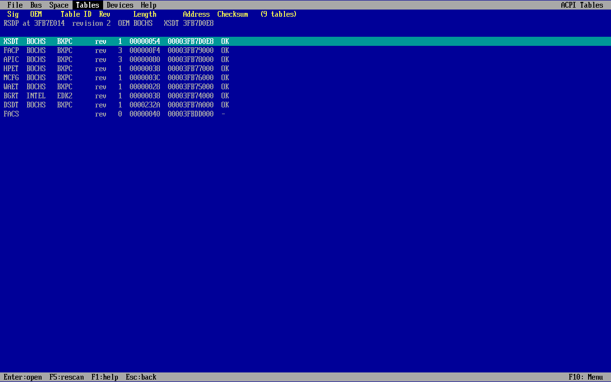 |

| File menu | File browser |
|---|---|
| 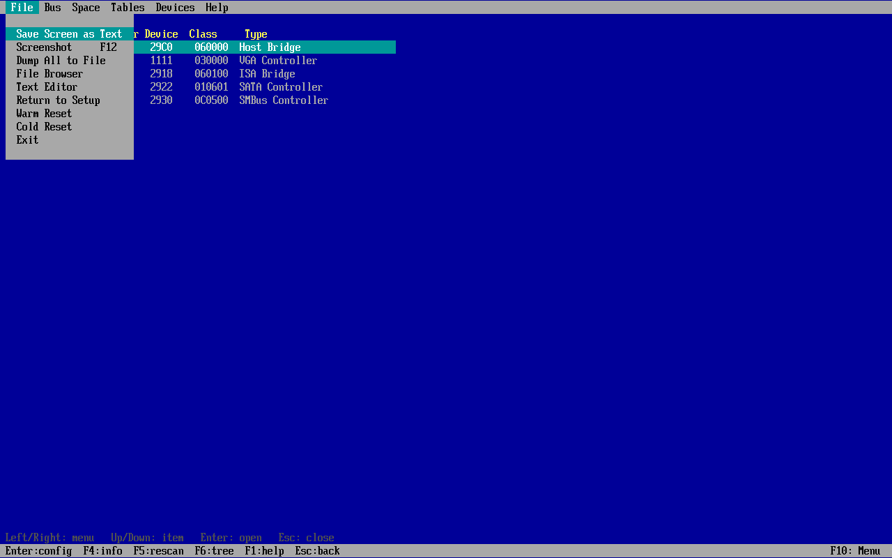 | 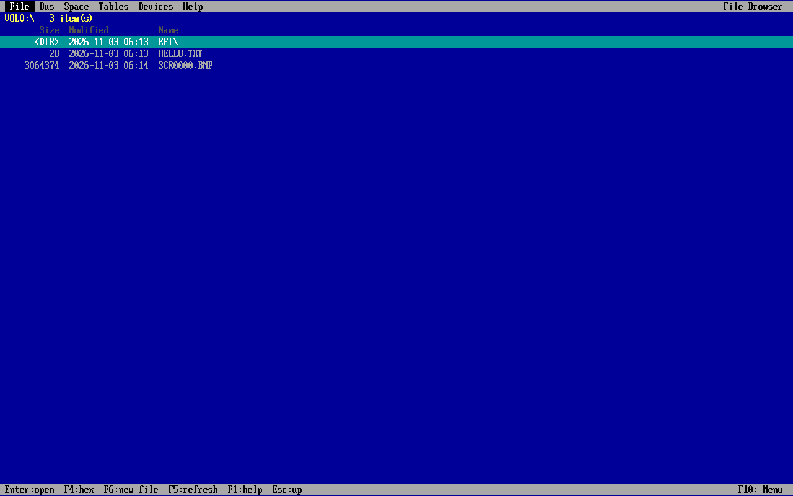 |

| Text editor | |
|---|---|
| 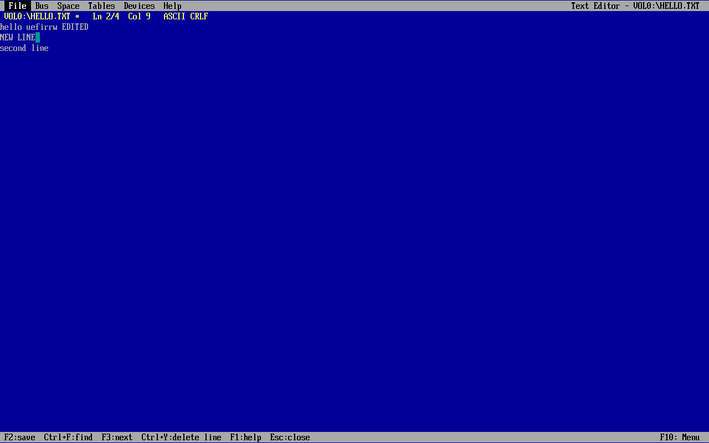 | |

| CMOS | ACPI find in ASL |
|---|---|
| 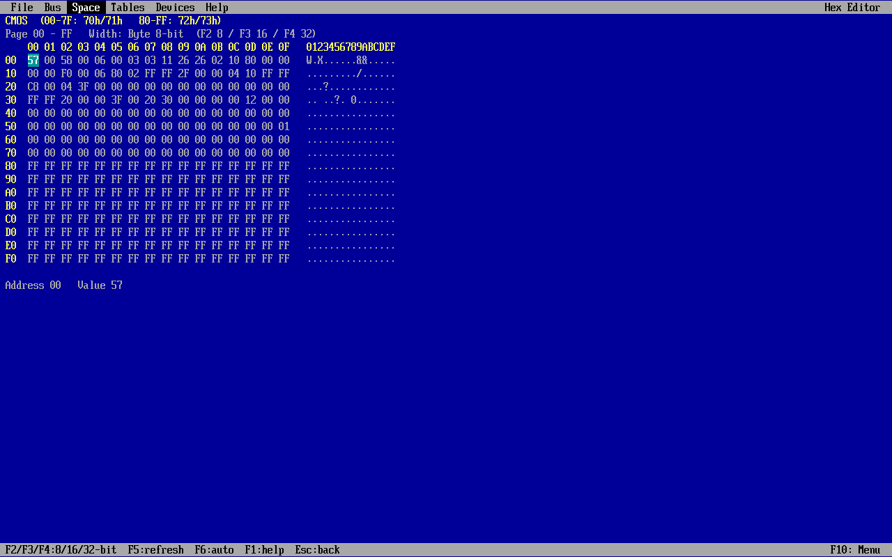 | 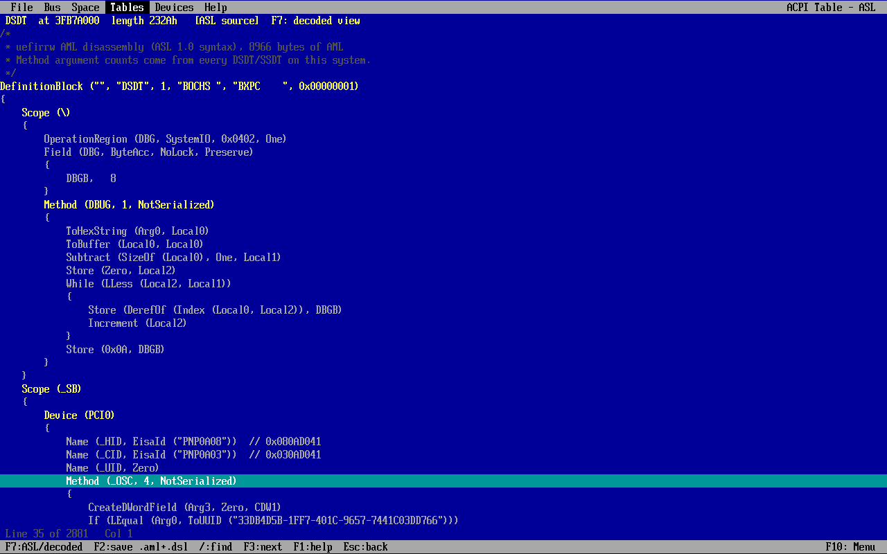 |

| USB hot-plug (auto refresh) | About |
|---|---|
| 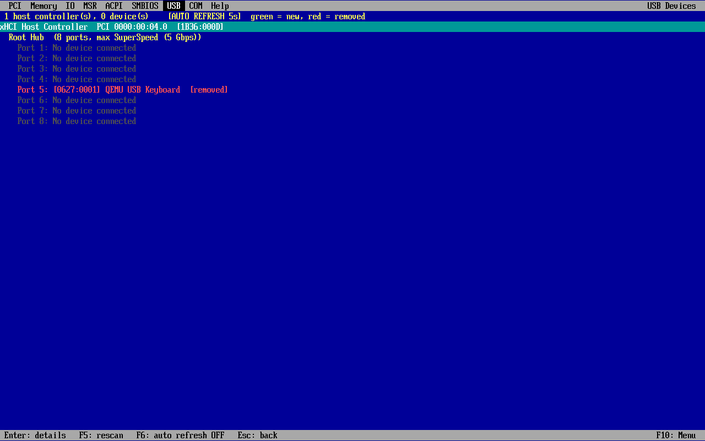 | 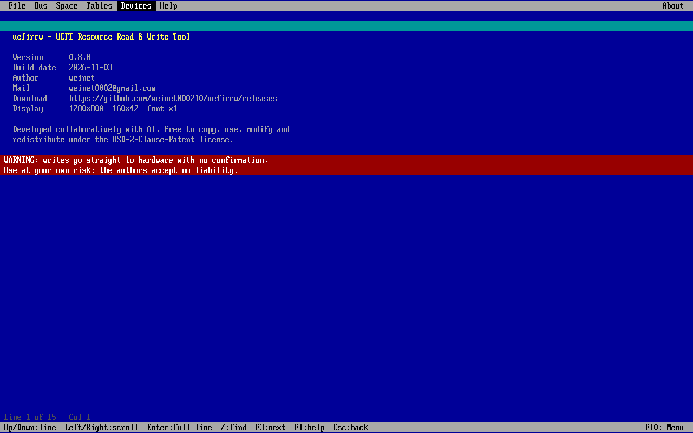 |

## Build

Requires an [edk2](https://github.com/tianocore/edk2) checkout (tested with `edk2-stable202408`), GCC, NASM and uuid-dev.

```bash
git clone --branch edk2-stable202408 https://github.com/tianocore/edk2.git
cd edk2 && git submodule update --init BaseTools/Source/C/BrotliCompress/brotli MdePkg/Library/MipiSysTLib/mipisyst
make -C BaseTools && cd ..
EDK2_DIR=$PWD/edk2 uefirrw/scripts/build.sh      # -> uefirrw/dist/uefirrw.efi
```

On non-x86 hosts install `gcc-x86-64-linux-gnu`; the script picks the cross prefix automatically. GitHub Actions builds `uefirrw.efi` on every push (artifact `uefirrw-X64`).

## Run

- UEFI Shell: copy `uefirrw.efi` to a FAT USB stick, then `fs0:` and `uefirrw.efi`.
- Direct boot: put it at `EFI/BOOT/BOOTX64.EFI` on a FAT32 stick (Secure Boot off).
- QEMU: `scripts/run-qemu.sh` (needs `qemu-system-x86` and `ovmf`).

> Writing to hardware registers can hang or damage a system. Use on test machines.

## Roadmap

Dump everything to a text file, Super I/O hardware monitor (fans, voltages, temperatures), SMBus / SPD, CPUID, PCIe MMIO UARTs, multi-core MSR, ASL+ syntax.

## Tested on

- QEMU q35 + OVMF (edk2-stable202408)
- A board with AMI BIOS (real hardware)

Results on other platforms may vary; please report what you find.

## License and credits

BSD-2-Clause-Patent. The built-in 8x19 font comes from the edk2 project (TianoCore), also under BSD-2-Clause-Patent. This is an independent implementation written from the public specifications.

## Reporting issues

Open a GitHub issue with your board / BIOS vendor, BIOS version, what you did, and a photo of the screen if possible.
