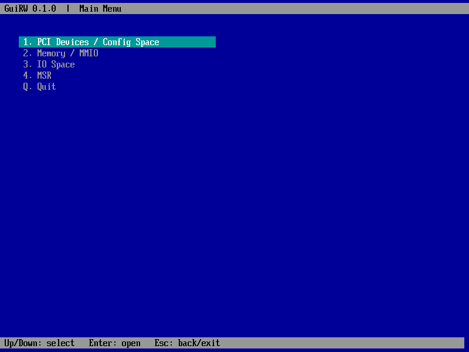
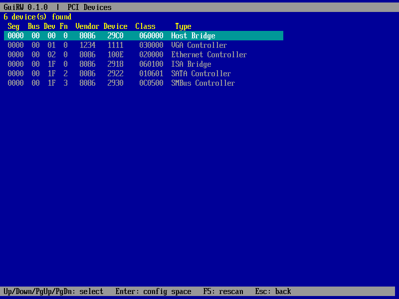
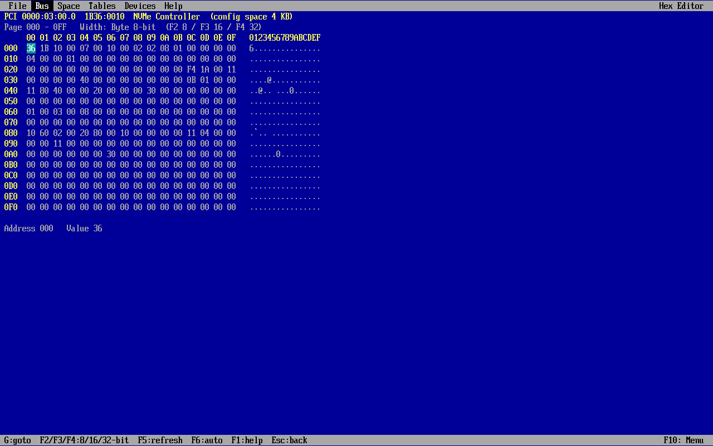
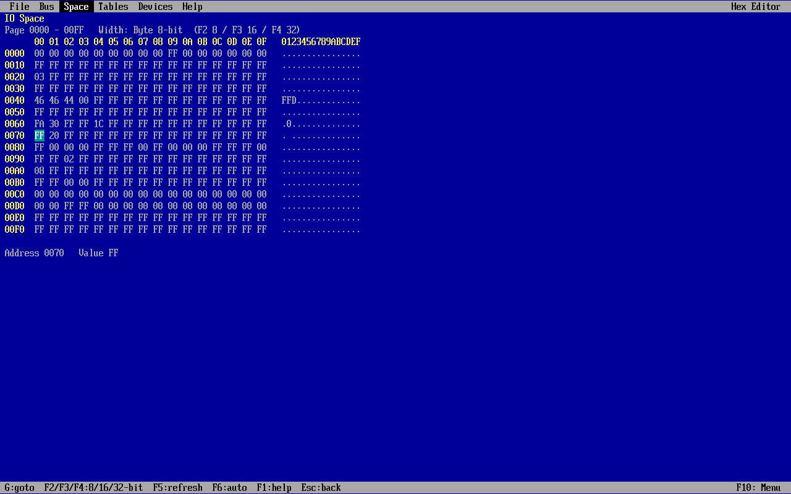
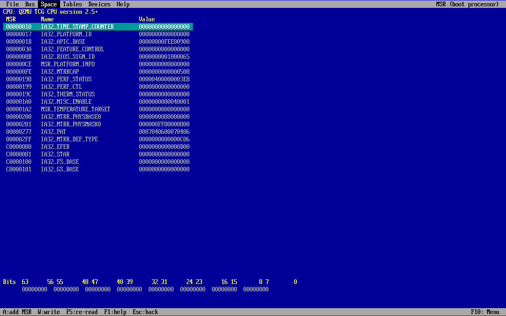
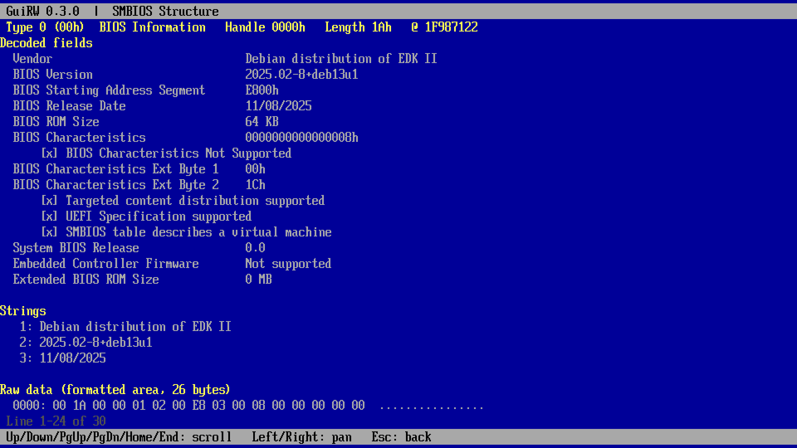
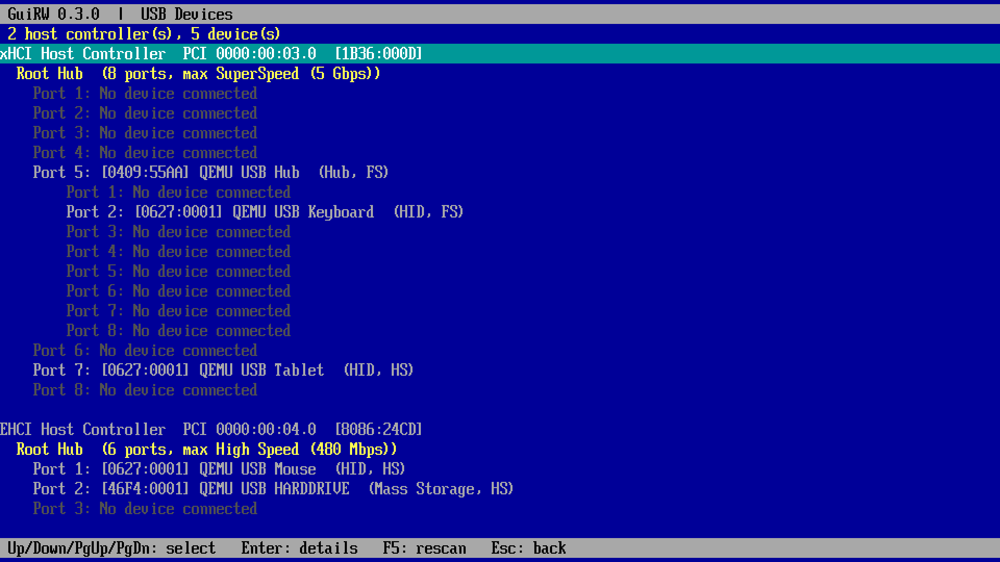

# GuiRW

GuiRW BIOS tool under UEFI — a text-mode, RW-Everything style hardware read/write utility that runs in the UEFI Shell (or boots directly as `BOOTX64.EFI`). No OS needed.



## Features (v0.3)

| Module | What it does |
|---|---|
| **PCI** | Scans every PCI root bridge (segment aware), lists Seg/Bus/Dev/Fn, vendor/device ID, class code and type. Enter opens the config space editor (256 B, or 4 KB extended space when reachable). |
| **Memory / MMIO** | Hex view/edit of any physical address (byte/word/dword access via MMIO reads). |
| **IO Space** | Hex view/edit of x86 IO ports 0000-FFFF in byte/word/dword width. |
| **MSR** | Boot-processor MSR list with common architectural MSRs, 64-bit bit view, add any MSR, write with confirmation. A temporary #GP handler skips faulting RDMSR/WRMSR so unsupported MSRs report an error instead of hanging. |
| **SMBIOS** | Finds the SMBIOS 3.x (or 2.x) entry point, lists every structure (type, handle, length, name). Enter shows decoded fields (types 0, 1, 2, 3, 4, 7, 8, 9, 11, 12, 13, 16, 17, 19, 32, 41), the string set, and a raw dump. |
| **USB Devices** | Tree of host controllers (xHCI/EHCI/OHCI/UHCI with PCI location), root hub ports, hubs and devices with VID:PID, product string, class and speed. Enter on a device shows connection info, the device descriptor, the full configuration set (interfaces, endpoints, HID, IAD, SuperSpeed companion), hub port status and raw descriptors; Enter on a controller shows its root port status. Read-only. |

Hex editor keys: arrows move, PgUp/PgDn change page, `W` cycles Byte/Word/DWord, `G` goes to an address, `F5` re-reads, type hex digits to edit (Enter or a full value commits; every write is read back and verified), `Esc` goes back.

PCI and IO writes always ask for confirmation.

| PCI devices | PCI config space |
|---|---|
|  |  |

| IO space | MSR |
|---|---|
|  |  |

Display: when the firmware exposes GOP, GuiRW draws its own 8x19 text (the edk2 font) at the panel's native resolution, with an integer font scale picked automatically so the grid fills the screen with at least 100x25 cells (e.g. 1920x1080 -> 120x28 at x2, 1024x768 -> 128x40 at x1). `F2` on the main menu cycles the font scale; the title bar shows resolution, grid and scale. Only changed cells are redrawn, so cursor movement stays fast even with serial console redirection enabled. Without GOP it falls back to the firmware text console.

| SMBIOS | USB tree |
|---|---|
|  |  |

## Build

Requires an [edk2](https://github.com/tianocore/edk2) checkout (tested with `edk2-stable202408`), GCC, NASM and uuid-dev.

```bash
git clone --branch edk2-stable202408 https://github.com/tianocore/edk2.git
cd edk2 && git submodule update --init BaseTools/Source/C/BrotliCompress/brotli MdePkg/Library/MipiSysTLib/mipisyst
make -C BaseTools && cd ..
EDK2_DIR=$PWD/edk2 GuiRW/scripts/build.sh      # -> GuiRW/dist/GuiRw.efi
```

On non-x86 hosts install `gcc-x86-64-linux-gnu`; the script picks the cross prefix automatically. GitHub Actions builds `GuiRw.efi` on every push (artifact `GuiRw-X64`).

## Run

- UEFI Shell: copy `GuiRw.efi` to a FAT USB stick, then `fs0:` and `GuiRw.efi`.
- Direct boot: put it at `EFI/BOOT/BOOTX64.EFI` on a FAT32 stick (Secure Boot off).
- QEMU: `scripts/run-qemu.sh` (needs `qemu-system-x86` and `ovmf`).

> Writing to hardware registers can hang or damage a system. Use on test machines.

## Roadmap

ACPI tables, CPUID, PCIe capability decode, EC / SMBus / SPD, multi-core MSR.

## License

BSD-2-Clause-Patent (same as edk2).
